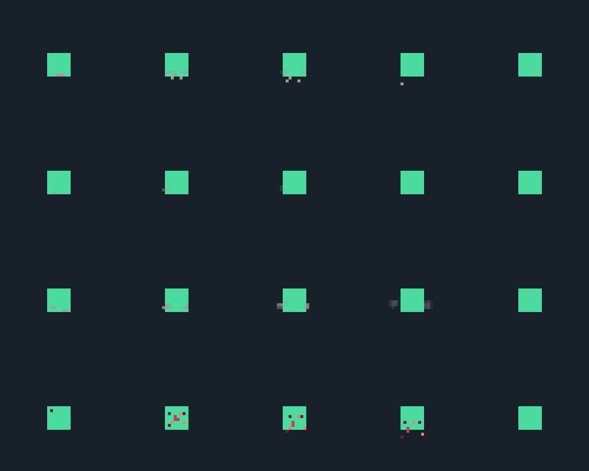

# 角色运动粒子效果

四套效果位于 `game/player/effects/`，由 `scenes/player/player.tscn` 中的 `MotionEffects` 节点自动播放。效果使用 PixelFX 0.3.0 的 BAKED 帧缓存，不需要额外贴图。

## 四种触发

- **跳跃**：运动组件真正设置 `just_jumped` 时播放，不是每次按跳跃键都播放。
- **奔跑**：着地且实际水平速度至少 8 px/s，每 0.14 秒产生一个脚后尘点；静止、空中和控制锁定时不持续产生。
- **落地**：从未着地变为着地的物理帧，在角色两侧产生轻微灰尘；首个采样帧不误报。
- **受伤重生**：仅 Killzone 显式请求。普通房间切换和 `respawn_at()` 只清理旧效果，不显示受伤粒子。

灰尘生成后停留在世界坐标，不随角色横移。所有一次性效果播放完后自动释放，重生会清理尚未结束的旧效果。效果固定使用 `z_index = 1`，在角色前方绘制，不依赖场景子节点顺序。

## 试玩

在 Godot 中打开 `examples/movement_lab/movement_lab.tscn` 并按 **F6**：

- **A / D** 或左右方向键：奔跑。
- **Space / Z**：跳跃，随后落地可看到两侧灰尘。
- 从场景左右两侧跌落：接触底部 Killzone，回到 `(40, 288)` 后显示红色下落碎粒。

该 Killzone 只用于示例场景，没有批量修改正式房间或生成房间。

## 在自己的关卡放置 Killzone

1. 将 `scenes/world/killzone.tscn` 实例化到源房间的 `RoomContent/Entities`。
2. 调整其 `CollisionShape2D`，覆盖陷阱或房间底部；默认碰撞掩码只检测玩家的第 2 层。
3. 保持角色由现有 StartSpawn / 检查点流程设置 `spawn_position`。

接触后的顺序固定为：读取 `spawn_position` → 调用 `respawn_at()` → 在传送后的坐标调用 `play_hurt_effect()`。Killzone 不扣血，也不另建出生点数据。

不要直接编辑 `scenes/rooms/generated/`；按项目既有烘焙流程更新运行时房间。

## 调整参数

- 颜色、粒子数量、速度和时长：各效果脚本的 `meta` 与 `create()`。
- 奔跑速度阈值与发射间隔：`PlayerMotionEffects.run_min_speed` 和 `run_step_interval`。
- 粒子随机种子：各效果 `meta.options.seed`，固定种子保证效果可复现。
- 运行时绘制：默认 BAKED；不要把四套效果改成 LIVE，除非正在编辑器中调试绘制。

## 预览与测试

预览图行顺序为 **jump、run、land、hurt**，列时间为 **0.00、0.08、0.16、0.28、0.44 秒**。绿色 8×8 方块用于表示当前角色尺寸，不是额外游戏素材。



重新生成预览：

```powershell
godot --headless --path . -s res://tests/player/render_player_motion_effects.gd
```

单独运行新功能测试：

```powershell
godot --headless --path . -s res://tests/run_test_script.gd -- res://tests/player/test_player_motion_effects.gd
godot --headless --path . -s res://tests/run_test_script.gd -- res://tests/world/test_killzone.gd
```

PixelFX 的 MIT 许可证和第三方声明位于 `addons/pixelfx/LICENSE` 与 `addons/pixelfx/NOTICE.md`。
